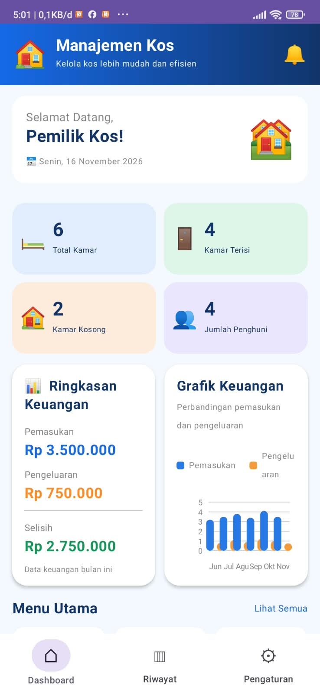
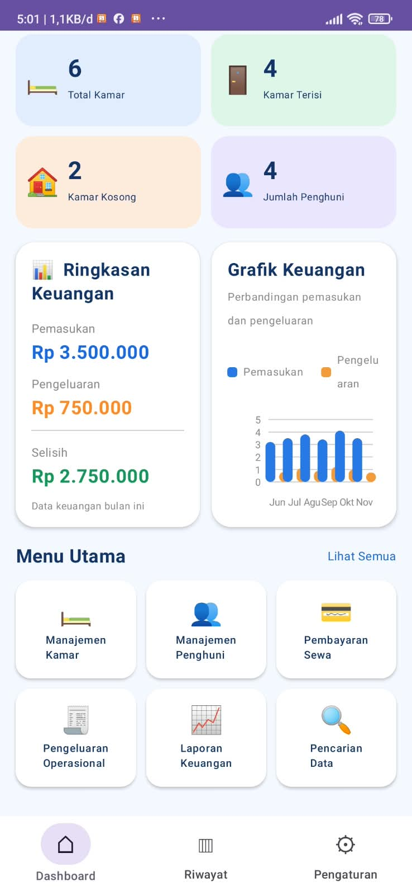

# Pengumpulan UTS Pemrograman Mobile

## Identitas Mahasiswa

- **Nama:** Salva Novian Dinata
- **NIM:** 2305101023
- **Kelas:** TIF 7B
- **Program Studi:** Teknik Informatika
- **Mata Kuliah:** Mobile Programming
- **Tahun Akademik:** 2026/2027

## Deskripsi

Repository ini berisi source code, dokumentasi, dan hasil implementasi aplikasi mobile **KosMajuJaya** yang dibuat untuk memenuhi tugas Ujian Tengah Semester (UTS) mata kuliah Pemrograman Mobile.

Aplikasi KosMajuJaya merupakan aplikasi manajemen kos berbasis Android yang dirancang untuk membantu pemilik kos dalam melihat informasi kamar, penghuni, pembayaran sewa, pengeluaran operasional, dan laporan keuangan melalui satu aplikasi.

## Deskripsi Pengerjaan UTS

Pada pengerjaan UTS Pemrograman Mobile ini, aplikasi yang dikembangkan adalah **KosMajuJaya**, yaitu aplikasi manajemen kos yang ditujukan untuk pemilik kos.

## Teknologi yang Digunakan

- **Bahasa Pemrograman:** Kotlin
- **Framework:** Jetpack Compose
- **Tools:** Android Studio
- **UI Design:** Material Design 3
- **Platform:** Android

## Fitur yang Diimplementasikan

1. **Dashboard:** Menampilkan halaman utama aplikasi dengan informasi dan ringkasan kondisi kos.
2. **Informasi Kamar dan Penghuni:** Menampilkan ringkasan jumlah seluruh kamar, kamar terisi, kamar kosong, dan jumlah penghuni.
3. **Ringkasan Keuangan:** Menampilkan informasi pemasukan, pengeluaran, dan selisih keuangan.
4. **Grafik Keuangan:** Menampilkan visualisasi perbandingan pemasukan dan pengeluaran selama enam bulan.
5. **Menu Utama:** Menyediakan tampilan menu Manajemen Kamar, Manajemen Penghuni, Pembayaran Sewa, Pengeluaran Operasional, Laporan Keuangan, dan Pencarian Data.
6. **Navigasi Aplikasi:** Menyediakan navigasi Dashboard, Riwayat, dan Pengaturan.

## Struktur Folder

- `app/`: Berisi source code utama aplikasi Android.
- `app/src/main/java/`: Berisi kode program Kotlin dan komponen antarmuka aplikasi.
- `app/src/main/res/`: Berisi resource aplikasi seperti ikon, gambar, dan konfigurasi tampilan.
- `app/src/main/AndroidManifest.xml`: Berisi konfigurasi utama aplikasi Android.
- `gradle/`: Berisi konfigurasi Gradle yang digunakan dalam pengembangan aplikasi.
- `uts/`: Berisi source code dan file pendukung UTS.
- `uts/screenshots/`: Berisi dokumentasi screenshot hasil implementasi aplikasi.

## Persyaratan Menjalankan Aplikasi

Untuk menjalankan aplikasi KosMajuJaya, diperlukan beberapa perangkat lunak dan komponen berikut:

1. Android Studio.
2. Android SDK.
3. Gradle.
4. Perangkat Android atau emulator Android.
5. Kabel USB apabila menggunakan perangkat Android secara langsung untuk proses pengujian.

## Cara Menjalankan Aplikasi

1. Clone atau download repository aplikasi KosMajuJaya.
2. Buka Android Studio.
3. Pilih menu **Open**.
4. Pilih folder project aplikasi KosMajuJaya.
5. Tunggu proses Gradle Sync hingga selesai.
6. Hubungkan perangkat Android melalui USB atau jalankan emulator Android.
7. Klik tombol **Run** pada Android Studio.
8. Tunggu proses build dan instalasi aplikasi selesai.
9. Aplikasi KosMajuJaya akan terbuka pada perangkat Android.

## Screenshot Hasil Implementasi

Dokumentasi screenshot hasil implementasi aplikasi dapat dilihat pada folder [`uts/screenshots/`](uts/screenshots/).

Screenshot yang disertakan meliputi:

1. **Tampilan Halaman Dashboard**
    
   

2. **Tampilan Menu Utama Aplikasi**
    
   

